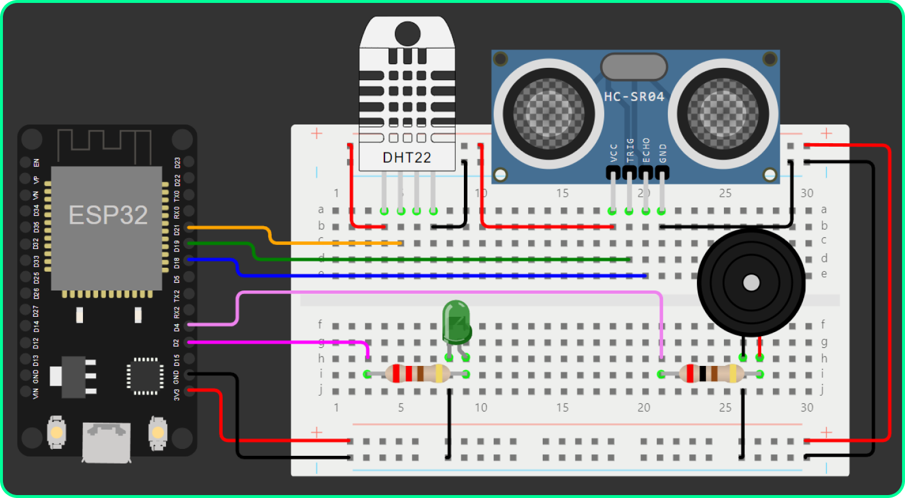
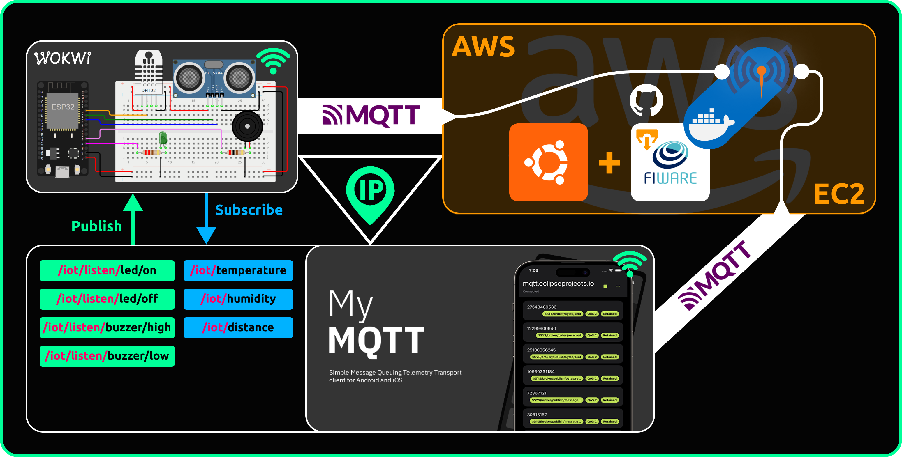

**[Simulador](https://wokwi.com/projects/411876289650649089) · [Publicação](https://www.linkedin.com/posts/kaique-zaffarani_arduino-esp32-aws-activity-7253072356754030594-deEF)**

Este projeto visa conectar um simulador (montado no site Wokwi, um simulador de eletrônica online) a uma instância EC2 (máquina virtual da Amazon Web Services) com o sistema operacional Ubuntu e um repositório do GitHub clonado, que simplifica serviços da plataforma de código aberto FIWARE. O repositório apresenta contêineres Docker (aplicações de código isoladas), e para o sistema foi utilizado o Mosquitto (broker MQTT) diretamente de um contêiner Docker, viabilizando a comunicação com o simulador por meio do MyMQTT.



---

## Estrutura do sistema

A estrutura do sistema IoT (internet das coisas) é baseada em três pilares principais:

| Pilar | Papel |
|---|---|
| **Simulador** | Conecta sensores e atuadores ao ESP32 (microcontrolador) e transmite os dados via protocolo de comunicação MQTT para o EC2 |
| **EC2** | Máquina virtual, com o Ubuntu instalado, que atua como servidor para manipular e enviar dados recebidos do simulador por meio do Mosquitto |
| **MyMQTT** | Aplicativo que se inscreve ou publica em tópicos MQTT (previamente estabelecidos) por meio da conexão IP do EC2 com o simulador, permitindo o controle de seus sensores e atuadores |

---

## Arquitetura



---

## Código do simulador (`docs/simulator.ino`)

- **Inclusão de bibliotecas** | Importa as bibliotecas necessárias para a operação do ESP32 e a comunicação com os sensores, permitindo o uso de funções específicas para cada tipo de sensor conectado.
- **Definição de portas de entrada** | Estabelece as portas digitais e analógicas do ESP32 que serão usadas para conectar e ler os dados dos sensores, garantindo a correta configuração do hardware.
- **Referenciamento e leitura dos sensores** | Configura e lê os dados dos sensores DHT22 e HC-SR04, processando as informações de temperatura, umidade e distância.
- **Constantes de endereços** | Recebe valores que permitem a comunicação do sistema, como rede Wi-Fi, endereço IP da máquina virtual e porta do broker MQTT.
- **Constantes de tópicos MQTT** | Recebe rotas que permitirão a comunicação com o broker MQTT através de inscrição e publicação de informações.
- **Funções de inicialização** | Inicia o módulo Wi-Fi do ESP32, o broker MQTT, juntamente com seus futuros tópicos e sensores do simulador.
- **Funções de publicação** | Permitem enviar dados dos sensores através de seus respectivos tópicos para a máquina virtual.
- **Callback MQTT** | O broker MQTT traz mensagens inscritas em um tópico no MyMQTT para o simulador. A função as interpreta por meio de códigos condicionais e executa as ações nos atuadores relacionados ao tópico.
- **Funções de verificação em loop** | Verifica a conexão Wi-Fi do simulador e a conexão com o broker MQTT, além de confirmar o status com mensagens na serial do simulador.

---

## Montagem do simulador

| Qtd. | Componente | Preço |
|---|---|---|
| 1x | Cabo USB A | R$ 15,00 |
| 1x | ESP32-DevKitC V4 [(documentação)](https://docs.espressif.com/projects/arduino-esp32/en/latest/) | R$ 50,00 |
| 1x | Sensor de distância ultrassônico HC-SR04 [(documentação)](https://web.eece.maine.edu/zhu/book/lab/HC-SR04%20User%20Manual.pdf) | R$ 13,00 |
| 1x | Sensor de umidade e temperatura DHT22 [(documentação)](https://www.mouser.com/datasheet/2/737/dht-932870.pdf) | R$ 40,00 |
| 1x | LED verde difuso de 5 mm | R$ 0,50 |
| 1x | Buzzer piezoelétrico ativo de 5 V [(documentação)](https://wiki-content.arduino.cc/documents/datasheets/PIEZO-PKM22EPPH4001-BO.pdf) | R$ 4,00 |
| 1x | Resistor de 220 Ω | R$ 2,00 |
| 1x | Resistor de 200 Ω | R$ 2,00 |
| 1x | Placa de ensaio (de preferência com 830 pontos) | R$ 20,00 |
| 15x | Cabos jumper macho-macho (contados com a placa de ensaio incluída) | R$ 3,00 |
| | **Total** | **R$ 149,50** |

---

## Como executar

1. Clone o repositório:
```bash
git clone https://github.com/Z4ffarani/IoThunder.git
cd IoThunder
```

2. O documento `criacao-servidor-e-maquina-virtual`, localizado na pasta `docs`, informa o passo a passo necessário para criar uma máquina virtual (podendo ser tanto localmente quanto em nuvem por meio do provedor de infraestrutura de preferência), instalar o Ubuntu (distribuição Linux de preferência) e clonar o repositório do GitHub com serviços do FIWARE, configurando-os em contêineres Docker (obrigatório).

3. Para rodar o simulador, abra o link do **[Wokwi](https://wokwi.com/projects/411876289650649089)** e clique no botão de iniciar. Levará algum tempo até que o simulador se conecte à rede pública do Wokwi e ao EC2. É possível regular os níveis de condição relacionados aos sensores clicando neles, para que assim sejam registrados no EC2 e enviados para o MyMQTT. Para utilização do simulador físico, é necessário executar o código presente no arquivo `simulator.ino` na pasta `docs`, assim como instalar as bibliotecas dos sensores presentes na pasta `libraries`. O programa **[Arduino IDE](https://www.arduino.cc/en/software)** é adequado para o teste.

4. Instale o aplicativo **[MyMQTT](https://mymqtt.app/en)**, ou qualquer outro que permita a conexão de endereço IP (protocolo de internet) e porta 1883 de uma máquina virtual. No aplicativo, caso a mensagem de publicação (publish) no tópico MQTT `iot/listen` seja `led/on`, o LED liga no simulador e desliga com `led/off`. Se a mensagem no mesmo tópico for `buzzer/high`, o buzzer é acionado com uma frequência aguda, e com `buzzer/low`, uma frequência grave, ambas em um intervalo de 500 milissegundos.

---

## Observações

- Os preços dos componentes do simulador estão sujeitos a valorização ou desvalorização.
- Para o simulador físico, o uso contínuo de sensores pode resultar em um maior consumo de energia. É recomendável implementar modos de economia de energia, como intervalos de sono, para prolongar a vida útil da bateria, se o sistema for alimentado por bateria.
- A estabilidade da conexão Wi-Fi é fundamental para o funcionamento do sistema. Para o simulador físico, verifique se o módulo ESP32 está dentro do alcance da rede sem fio para garantir a transmissão confiável de dados.
- As bibliotecas escolhidas para o simulador têm recursos ainda mais complexos para serem implementados.
- É necessário alterar o endereço IP e porta do broker MQTT no simulador para que ele se conecte à máquina virtual escolhida.
- É essencial configurar o Mosquitto corretamente na máquina virtual para permitir a comunicação entre o simulador e o MyMQTT. Testes prévios com o Postman (plataforma de desenvolvimento de API) ajudarão a validar dependências instaladas.
- Existe a possibilidade de renomear e alterar as funcionalidades dos tópicos MQTT no simulador para atender a diferentes necessidades na aplicação IoT, bem como os sensores e atuadores dispostos.
- Para a máquina virtual em nuvem, dependendo do provedor de infraestrutura escolhido, é importante averiguar valores e planos gratuitos que podem se tornar pagos antes de ativar instâncias. O término da instância após testes é recomendado para evitar cobranças inesperadas.
- O EC2 utilizado no projeto permanecerá parado, sendo necessário criar uma máquina virtual rodando em outro provedor para uma aplicação IoT própria.
- O endereço IP de uma máquina virtual em nuvem se altera uma vez que é parada, necessitando alterá-lo no simulador e no MyMQTT quando reativada.

---

## Tecnologias

[](https://www.arduino.cc/en/software)
[](https://www.espressif.com/en/products/socs/esp32)
[](https://mqtt.org)
[](https://mosquitto.org)
[](https://www.docker.com)
[](https://aws.amazon.com/ec2)
[](https://ubuntu.com)

---

## Referências

| # | Referência | Aplicação no projeto |
|---|---|---|
| 1 | [fiware](https://github.com/fabiocabrini/fiware) | Repositório com os serviços FIWARE em contêineres Docker clonado na máquina virtual |
| 2 | [Instalação de bibliotecas no Arduino IDE](https://docs.arduino.cc/software/ide-v1/tutorials/installing-libraries/) | Instalação das bibliotecas dos sensores da pasta `libraries` |
| 3 | [How to Create an EC2 Instance in AWS in 2023](https://www.youtube.com/watch?v=0Gz-PUnEUF0&t=526s) | Criação da instância EC2 usada como servidor |
| 4 | [Aula 1 - Configuração de um dispositivo no Fiware](https://www.youtube.com/watch?v=8oHkAlXdWo8) | Configuração do dispositivo IoT no FIWARE |

---

## Agradecimentos

- **[Paulo Marcotti](https://www.youtube.com/@pmarcotti)**
- **[Fábio Henrique Cabrini](https://github.com/fabiocabrini)**
